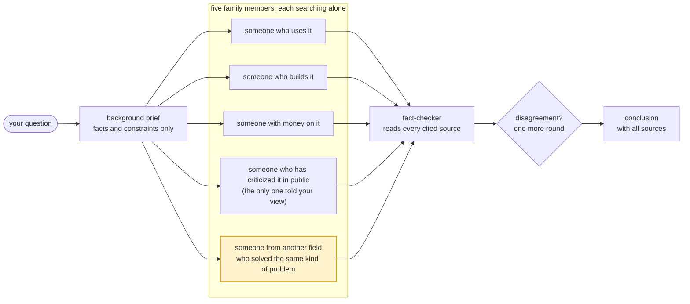

<p align="center"><b>English</b> · <a href="README.zh-CN.md">简体中文</a></p>

<div align="center">

# family

**One question. Five points of view. Every source checked.**

A multi-perspective research skill based on Stanford's STORM. Five family members with different backgrounds<br>research your question independently, a fact-checker verifies every source they cite, and you get a sourced conclusion.


[](LICENSE)
[](https://agentskills.io)
[](CHANGELOG.md)
[](#install)

[Install](#install) · [Usage](#usage) · [How it works](#how-it-works)

<sub><i>"I don't have friends. I got family."</i><br>Dominic Toretto</sub>

</div>

## When to use it

- You're new to a field and want the full picture fast.
- You want to know whether a claim, or a wave of hype, holds up.
- You're about to make a call and want to know what you've missed.

For single facts, long-form writing, or picking between A and B for you, other tools fit better.

## Install

**Tell your agent:**

```text
Install this skill: https://github.com/xhyumiracle/family-skill
```

**Or use the Agent Skills installer:**

```bash
npx skills add xhyumiracle/family-skill -g
```

**Or, on Claude Code, the full install:**

```bash
git clone https://github.com/xhyumiracle/family-skill && ./family-skill/install.sh
```

The full install adds two agent definitions that cannot spawn subagents, so the family stays the size you see. Start a new session afterwards.

Needs an agent with subagents and web search. Tested on Claude Code; Codex, Cursor, Gemini CLI and OpenCode support subagents too and should work.

<!-- Agents installing this for someone: on Claude Code use the full install (install.sh); on any other runtime use the npx line. -->

## Usage

```
/family <question>          five family members + a fact-checker · ~30 min · ~650K tokens
/family quick <question>    one fast pass, still fact-checked · ~80K tokens
/family deep <question>     the same five, more claims checked, extra rounds on disagreements (up to 3)
```

Or just say it: "help me understand X from scratch", "is the hype about X real", "what am I missing about X".

You get `family/<short-name>/report.md`. It opens with three lines: what to do, how confident to be, and which assumption would change the answer. Below that: key findings, where the family members disagree, and what nobody looked into, each with its source.

## How it works



- **Spread-out perspectives.** Five people from five trades read largely different material. In STORM's experiments, asking from several perspectives nearly doubled the distinct sources found (99.83 vs 54.36).
- **Five is enough.** Averaging three analysts' independent judgments already captures most of the gain of averaging fifty (Mandel et al., 2018), and Delphi panels of 3 to 11 show no difference in accuracy (Rowe & Wright, 2001). Five covers four fixed perspectives plus one from another field; each extra person only adds cost, about 70–110K tokens.
- **Four fixed roles, one from another field.** A role decides where each person looks: giving a model a persona alone leaves its accuracy unchanged (Zheng et al., 2024), while reading different material helps. Someone who uses it, someone who builds it, someone with money on it, and someone who has criticized it in public read different things by nature. The fifth comes from a field that has solved the same kind of problem: asked how several AI agents should combine their findings, family called an intelligence-analysis methodologist. That seat is experimental, with no controlled study yet.
- **Independent work, one merge.** The gains from AI agents debating are almost entirely explained by voting (Choi et al., NeurIPS 2025), and working alone avoids conformity.
- **Real dissent.** Only the critic hears your view; everyone else gets facts only, so nobody bends toward you (Sharma et al., ICLR 2024). The critic looks for published dissent, which corrects a group better than an assigned devil's advocate (Nemeth et al., 2001).
- **Faithful citations.** Deep-research tools cite correctly 40–80% of the time (DeepTRACE, ICLR 2026). The fact-checker opens every key source and downgrades claims the source doesn't support. Numbers and quotes in the conclusion are then matched word for word against the fact-checker's table, since a 2026 study traced 84.7% of report errors to the orchestrating agent that writes the final report.
- **One more round on disagreements.** Each side sees the other's checked evidence anonymously and can hold with a new source, concede, or show the two define a term differently. It stops when the evidence stops changing (the Delphi method).

A full run, every intermediate file included: [`examples/family-skill-design/`](examples/family-skill-design/), family reviewing its own design. The evidence behind each choice: [docs/DESIGN.md](docs/DESIGN.md).

## References

- Shao et al. *Assisting in Writing Wikipedia-like Articles From Scratch with LLMs* (STORM). NAACL 2024. [arxiv.org/abs/2402.14207](https://arxiv.org/abs/2402.14207)
- Jiang et al. *Into the Unknown Unknowns* (Co-STORM). EMNLP 2024. [arxiv.org/abs/2408.15232](https://arxiv.org/abs/2408.15232)
- Choi, Zhu, Li. *Debate or Vote: Which Yields Better Decisions in Multi-Agent LLMs?* NeurIPS 2025. [arxiv.org/abs/2508.17536](https://arxiv.org/abs/2508.17536)
- Zheng et al. *When "A Helpful Assistant" Is Not Really Helpful.* EMNLP Findings 2024. [arxiv.org/abs/2311.10054](https://arxiv.org/abs/2311.10054)
- Venkit et al. *DeepTRACE.* ICLR 2026. [arxiv.org/abs/2509.04499](https://arxiv.org/abs/2509.04499)
- Kim et al. *Towards a Science of Scaling Agent Systems.* 2025. [arxiv.org/abs/2512.08296](https://arxiv.org/abs/2512.08296)
- *Who is the Agent to Blame? Localizing Faithfulness and Citation Mistakes in Agentic Deep Research.* 2026. [arxiv.org/abs/2608.24306](https://arxiv.org/abs/2608.24306)
- Sharma et al. *Towards Understanding Sycophancy in Language Models.* ICLR 2024. [arxiv.org/abs/2310.13548](https://arxiv.org/abs/2310.13548)
- Nemeth, Brown, Rogers. *Devil's advocate versus authentic dissent.* Eur. J. Soc. Psychol. 2001.
- Lee et al. *"Fact-checking" fact checkers.* HKS Misinformation Review 2023.
- Rowe, Wright. *Expert opinions in forecasting: the role of the Delphi technique.* 2001.
- Mandel, Karvetski, Dhami. *Boosting intelligence analysts' judgment accuracy.* Judgment and Decision Making 2018.
- Intelligence Community Directive 203, *Analytic Standards.* 2015, rev. 2023.
- Rosenbaum, Glenton, Oxman. *Summary-of-findings tables in Cochrane reviews improved understanding and rapid retrieval of key information.* J Clin Epidemiol 2010.
- Miller. *Adding Error Bars to Evals.* 2024. [arxiv.org/abs/2411.00640](https://arxiv.org/abs/2411.00640)
- Anthropic. *How we built our multi-agent research system.* 2025. [anthropic.com/engineering/multi-agent-research-system](https://www.anthropic.com/engineering/multi-agent-research-system)

<sub>MIT · similar projects read first: claude-storm, storm-research, panel-skill, perspectives-skill, dotclaude · stills from *Fast Five*, Universal Pictures</sub>
