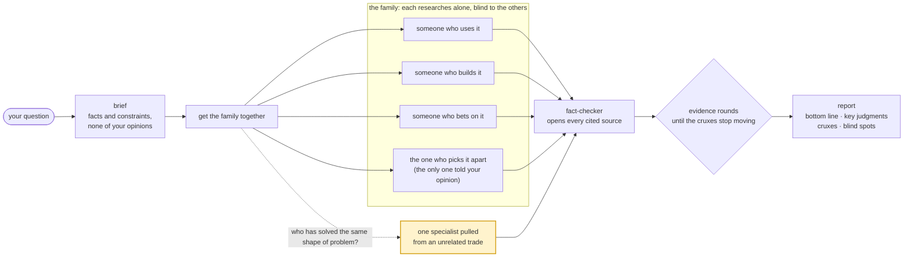

<p align="center"><b>English</b> · <a href="README.zh-CN.md">简体中文</a></p>

<div align="center">

# family

<sub>"I don't have friends. I got family." · Dominic Toretto</sub>


**Five people from five trades research your question, each on their own.<br>Then a fact-checker opens every link they cite.**

[](LICENSE)
[](https://agentskills.io)
[](CHANGELOG.md)
[](#install)

[See it work](#see-it-work) · [Install](#install) · [How it works](#how-it-works) · [Why it's built this way](docs/DESIGN.md)

</div>

## Why bother

- **One point of view finds about half the sources.** In STORM's ablation, research guided by several perspectives found 99.83 distinct sources per topic; without them, 54.36.
- **AI research citations hold up 40–80% of the time.** That is what DeepTRACE (ICLR 2026) measured across deep-research agents.
- **family keeps its own score.** Across four real runs the fact-checker opened 78 cited claims. 17 of them did not fully say what the agent claimed, and were downgraded before they reached the report.

## See it work

### Who it calls

The casting step's actual output for *"Is a CGM worth wearing if you're not diabetic?"*:

| | Family member | Why this one |
|---|---|---|
| Uses it | A healthy user, three months on a Stelo or Lingo | fixed seat |
| Builds it | An endocrinologist who runs a metabolic-health clinic | fixed seat |
| Bets on it | A VC in consumer medical devices | fixed seat |
| Picks it apart | An evidence-based-medicine researcher of the kind who wrote [JAMA Internal Medicine's "no evidence" review](https://doi.org/10.1001/jamainternmed.2026.2772) | fixed seat, cast from real published dissent |
| Outsider | An epidemiologist who studies overdiagnosis | same shape as PSA screening: a medical sensor sold to healthy people, noisy readings taken as diagnoses |

### What the fact-checker catches

From a real run ([verification.md](examples/family-skill-design/verification.md), row 14):

> **A family member wrote:** "When two models are both wrong, they give the same wrong answer about 60% of the time."
>
> **The source** ([arxiv.org/abs/2506.07962](https://arxiv.org/abs/2506.07962)): "*on one leaderboard dataset*, models agree 60% of the time when both models err."
>
> **PARTIAL ↓** One dataset, not a general rate. Downgraded before it reached the report.

### It audited itself

[`examples/family-skill-v03/`](examples/family-skill-v03/) is the skill run on its own design. The verifier opened 20 sources and found three things: structure that had never actually run, per-member counts with a selection bias, and a number in the orchestrator's own bottom line stitched together from two different tests. v0.3 is what came out of it.

## Install

**Tell your agent**, in any runtime:

```text
Install this skill: https://github.com/xhyumiracle/family-skill
```

**Or use the Agent Skills installer:**

```bash
npx skills add xhyumiracle/family-skill -g
```

**Or, on Claude Code, the full install:**

```bash
git clone https://github.com/xhyumiracle/family-skill && ./family-skill/install.sh
```

The full install also adds two agent definitions, `family-member` and `family-verifier`, which have no tool for spawning helpers, so the headcount you approve is the headcount you pay for. Start a new session afterwards. (Agents installing this for someone: use the full install on Claude Code, the `npx` line anywhere else.)

It needs subagents and web search. Tested on Claude Code. Codex, Cursor, Gemini CLI and OpenCode all have subagents and should run it; that is untested. Without subagents only `quick` runs. No model is named anywhere: every family member runs on your default.

## Use

```
/family <question>          5 family members + fact-checker · ~30 min · ~650K tokens
/family quick <question>    no family: one search pass, a small fact-checker checks it
/family deep <question>     same five · more claims checked · evidence rounds until the cruxes stop moving (max 3)
```

Or just ask: "what am I missing about X", "is the hype about X real", "help me understand X from zero". The report lands in `family/<slug>/report.md`.

## How it works



- **Nobody talks during fieldwork.** Agreement between several copies of one model is conformity, not evidence, so each family member works blind.
- **The skeptic is the only one told what you believe**, and goes looking for published dissent instead of inventing objections.
- **The outsider is cast by the shape of the problem**: bots and humans committing to one repo gets a CI engineer; many estimates to combine gets an intelligence analyst. Marked experimental.
- **"Discuss it further" means evidence rounds, not debate.** Each side of a disagreement gets the other's verified evidence anonymously; a member can hold with a new source, concede, or reframe. It stops when the evidence stops moving, not when they agree.
- **The orchestrator's own bottom line is checked word by word** against the fact-checker's table before you see it.

Every choice, with the paper behind it: [docs/DESIGN.md](docs/DESIGN.md).

## What you get

The first screen is for a reader with ten minutes; the audit trail sits below it.

| | |
|---|---|
| Bottom line | what to do · how likely, on a seven-level scale with a range · the assumption that would break it |
| Key judgments | at most seven, each with its strongest confirmed source and what would change it |
| Cruxes | where family members disagree, both sides sourced, what would settle it |
| Blind spots | what nobody looked at |
| Source summary | what the evidence is made of, and which claims the fact-checker downgraded |

## Not for

Picking A or B for you (it lays out the evidence; the choice is yours) · single facts · long articles · cheap research.

## References

The ones the design leans on most; the full list with page-level notes is in [docs/DESIGN.md](docs/DESIGN.md).

- Shao et al. *Assisting in Writing Wikipedia-like Articles From Scratch with LLMs* (STORM). NAACL 2024. [arxiv.org/abs/2402.14207](https://arxiv.org/abs/2402.14207)
- Jiang et al. *Into the Unknown Unknowns* (Co-STORM). EMNLP 2024. [arxiv.org/abs/2408.15232](https://arxiv.org/abs/2408.15232)
- Choi, Zhu, Li. *Debate or Vote: Which Yields Better Decisions in Multi-Agent LLMs?* NeurIPS 2025. [arxiv.org/abs/2508.17536](https://arxiv.org/abs/2508.17536)
- Zheng et al. *When "A Helpful Assistant" Is Not Really Helpful.* EMNLP Findings 2024. [arxiv.org/abs/2311.10054](https://arxiv.org/abs/2311.10054)
- Venkit et al. *DeepTRACE.* ICLR 2026. [arxiv.org/abs/2509.04499](https://arxiv.org/abs/2509.04499)
- Kim et al. *Towards a Science of Scaling Agent Systems.* 2025. [arxiv.org/abs/2512.08296](https://arxiv.org/abs/2512.08296)
- *Who is the Agent to Blame? Localizing Faithfulness and Citation Mistakes in Agentic Deep Research.* 2026. [arxiv.org/abs/2608.24306](https://arxiv.org/abs/2608.24306)
- Sharma et al. *Towards Understanding Sycophancy in Language Models.* ICLR 2024. [arxiv.org/abs/2310.13548](https://arxiv.org/abs/2310.13548)
- Nemeth, Brown, Rogers. *Devil's advocate versus authentic dissent.* Eur. J. Soc. Psychol. 2001.
- Lee et al. *"Fact-checking" fact checkers.* HKS Misinformation Review 2023.
- Mandel, Karvetski, Dhami. *Boosting intelligence analysts' judgment accuracy.* Judgment and Decision Making 2018.
- Intelligence Community Directive 203, *Analytic Standards.* 2015, rev. 2023.
- Rosenbaum, Glenton, Oxman. *Summary-of-findings tables in Cochrane reviews improved understanding and rapid retrieval of key information.* J Clin Epidemiol 2010.
- Miller. *Adding Error Bars to Evals.* 2024. [arxiv.org/abs/2411.00640](https://arxiv.org/abs/2411.00640)
- Anthropic. *How we built our multi-agent research system.* 2025. [anthropic.com/engineering/multi-agent-research-system](https://www.anthropic.com/engineering/multi-agent-research-system)

<sub>MIT · prior art read first: claude-storm, storm-research, panel-skill, perspectives-skill, dotclaude · stills from *Fast Five*, Universal Pictures</sub>
