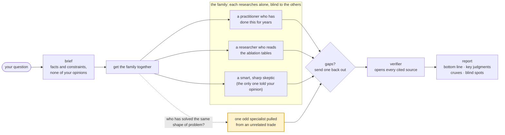

# family

> "I don't have friends. I got family." — Dominic Toretto


Get the family together before the job. A Claude Code skill: pull in family from different trades to research one question, each on their own, then send a fact-checker to open every source they leaned on.

English · [中文](README.zh-CN.md)

```
/family  Which parts of family's own research design have evidence behind them, and which are folklore?
```



## Install

```bash
git clone https://github.com/xhyumiracle/family-skill && ./family-skill/install.sh
```

Claude Code with subagents and web search. Start a new session after installing. No model is named anywhere; every family member runs on your subagent default.

## Use

```
/family <question>          5 family members + verifier · ~30 min · ~650K tokens
/family quick <question>    no crew: the orchestrator searches alone, a small verifier checks it
/family deep <question>     same family · bigger verifier · evidence rounds until the cruxes stop moving (max 3)
```

Or just ask: "what am I missing about X", "从0到1了解 X". Output lands in `family/<slug>/report.md`.

## What you get

First screen for a ten-minute reader, appendix for audit.

| | |
|---|---|
| Bottom line | what to do · how likely, on a seven-level scale with a range · the assumption that would break it |
| Key judgments | at most seven, each with its strongest confirmed source and what would change it |
| Cruxes | where family members disagree, both sides sourced, what would settle it |
| Blind spots | what nobody looked at |
| Source summary | what the evidence is made of, and the rows the verifier downgraded |

## Highlights

- **A fact-checker opens every source the conclusion rests on.** Four verdicts, two flags, and a quote inverted by truncation counts as misquoted. The best-evidenced part of the pipeline.
- **One family member is pulled from an unrelated trade.** Cast by the shape of the problem: bots and humans committing to one repo gets a CI engineer; many independent estimates to combine gets an intelligence analyst. Marked experimental, kept because it keeps finding the corner nobody looked at.
- **The skeptic is the only family member who knows what you believe**, and it goes looking for published dissent, not for objections of its own.
- **Family members work blind and never argue.** Agreement between several of them on one model is conformity, not evidence.
- **The orchestrator's own bottom line is checked word by word** against the verification table before you see it.
- **First screen in ten minutes, audit below the fold.** Three-slot bottom line on a seven-level likelihood scale, at most seven key judgments, cruxes with what would settle them.
- **It audited itself twice**, and v0.3 is what the audits produced.

Design rationale and the evidence behind each choice: [docs/DESIGN.md](docs/DESIGN.md).

## It audited itself

[`examples/family-skill-v03/`](examples/family-skill-v03/): the skill run on itself. Five family members: someone who writes deep-research benchmarks, a reader with ten minutes and a decision to make, a GRADE methodologist pulled in from medical evidence grading, a researcher who only reads ablation tables, and a skeptic. The verifier opened 20 sources. They found structure that had never run, per-member counts with a selection bias, and a stitched number in the orchestrator's own bottom line. v0.3.0 is the result.

## Not for

Picking A or B for you (it lays out the evidence; the choice is yours) · single facts · long articles · cheap research.

## References

The ones the design leans on most; the full list with page-level notes is in [docs/DESIGN.md](docs/DESIGN.md).

- Shao et al. *Assisting in Writing Wikipedia-like Articles From Scratch with LLMs* (STORM). NAACL 2024. [arxiv.org/abs/2402.14207](https://arxiv.org/abs/2402.14207)
- Jiang et al. *Into the Unknown Unknowns* (Co-STORM). EMNLP 2024. [arxiv.org/abs/2408.15232](https://arxiv.org/abs/2408.15232)
- Choi, Zhu, Li. *Debate or Vote: Which Yields Better Decisions in Multi-Agent LLMs?* NeurIPS 2025. [arxiv.org/abs/2508.17536](https://arxiv.org/abs/2508.17536)
- Zheng et al. *When "A Helpful Assistant" Is Not Really Helpful.* EMNLP Findings 2024. [arxiv.org/abs/2311.10054](https://arxiv.org/abs/2311.10054)
- Venkit et al. *DeepTRACE.* ICLR 2026. [arxiv.org/abs/2509.04499](https://arxiv.org/abs/2509.04499)
- Kim et al. *Towards a Science of Scaling Agent Systems.* 2025. [arxiv.org/abs/2512.08296](https://arxiv.org/abs/2512.08296)
- *Who is the Agent to Blame? Localizing Faithfulness and Citation Mistakes in Agentic Deep Research.* 2026. [arxiv.org/abs/2608.24306](https://arxiv.org/abs/2608.24306)
- Sharma et al. *Towards Understanding Sycophancy in Language Models.* ICLR 2024. [arxiv.org/abs/2310.13548](https://arxiv.org/abs/2310.13548)
- Nemeth, Brown, Rogers. *Devil's advocate versus authentic dissent.* Eur. J. Soc. Psychol. 2001.
- Lee et al. *"Fact-checking" fact checkers.* HKS Misinformation Review 2023.
- Mandel, Karvetski, Dhami. *Boosting intelligence analysts' judgment accuracy.* Judgment and Decision Making 2018.
- Intelligence Community Directive 203, *Analytic Standards.* 2015, rev. 2023.
- Rosenbaum, Glenton, Oxman. *Summary-of-findings tables in Cochrane reviews improved understanding and rapid retrieval of key information.* J Clin Epidemiol 2010.
- Miller. *Adding Error Bars to Evals.* 2024. [arxiv.org/abs/2411.00640](https://arxiv.org/abs/2411.00640)
- Anthropic. *How we built our multi-agent research system.* 2025. [anthropic.com/engineering/multi-agent-research-system](https://www.anthropic.com/engineering/multi-agent-research-system)

MIT · prior art read first: claude-storm, storm-research, panel-skill, perspectives-skill, dotclaude · stills from *Fast Five*, Universal Pictures
