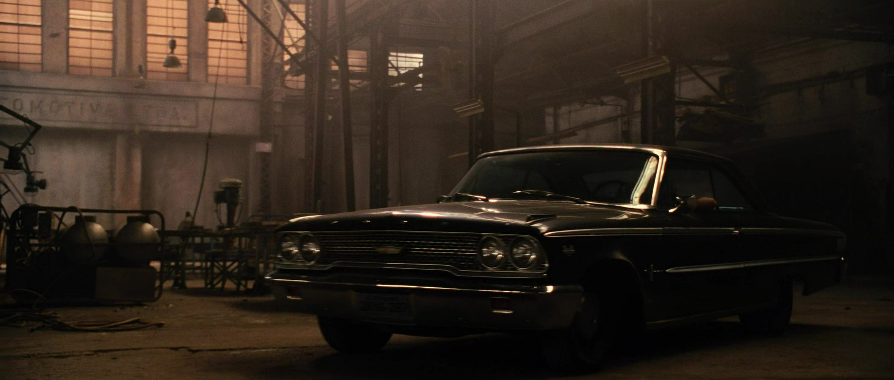
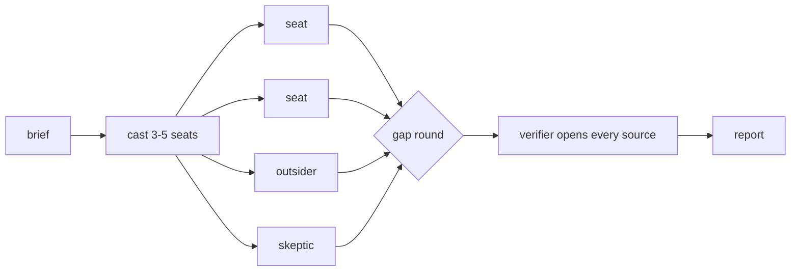

# family

> "I don't have friends. I got family." — Dominic Toretto



Get the family together before the job. A Claude Code skill that researches one question with a crew of independent seats, then sends a fact-checker to open every source they leaned on.

English · [中文](README.zh-CN.md)

```
/family  What in this skill's own design has evidence behind it, and what is folklore?
```



## Install

```bash
git clone https://github.com/xhyumiracle/family-skill && ./family-skill/install.sh
```

Claude Code with subagents and web search. Start a new session after installing. No model is named anywhere; seats run on your subagent default.

## Use

```
/family <question>          3-5 seats + verifier · ~25 min · ~700K tokens
/family quick <question>    one pass + small verifier
/family deep <question>     6 seats · bigger verifier · gap round on
```

Or just ask: "what am I missing about X", "从0到1了解 X". Output lands in `family/<slug>/report.md`.

## What you get

First screen for a ten-minute reader, appendix for audit.

| | |
|---|---|
| Bottom line | what to do · how likely, on a seven-level scale with a range · the assumption that would break it |
| Key judgments | at most seven, each with its strongest confirmed source and what would change it |
| Cruxes | where seats disagree, both sides sourced, what would settle it |
| Blind spots | what nobody looked at |
| Source summary | what the evidence is made of, and the rows the verifier downgraded |

## Rules, and why

| Rule | Because | |
|---|---|---|
| Seats write blind; one writer after | debate adds little beyond voting; peers flip right answers | [1] [2] |
| Seats are search territories, not personas | personas do not raise accuracy; different sources do | [3] [4] [5] |
| Your own opinion goes only to the skeptic | a stated belief pulls answers toward it | [6] |
| The skeptic hunts published dissent | assigned devil's advocates lose to real ones | [7] |
| One verifier, four verdicts | 40-80% citation accuracy in production; fine-grained labels do not reproduce | [8] [9] [10] |
| The bottom line is checked word by word | most final-report errors start at the orchestrator | [11] |
| ≤7 judgments, likelihood scale, audit below the fold | what intelligence and systematic-review standards converged on | [12] [13] [14] |
| Searches per seat before more seats | token budget explains 80% of the variance | [15] |
| Outsider seat and gap round: on, marked experimental | no controlled study yet | |

Sources and the full argument: [docs/DESIGN.md](docs/DESIGN.md).

## It audited itself

[`examples/family-skill-v03/`](examples/family-skill-v03/): five seats (a benchmark author, a ten-minute reader, a GRADE methodologist, a researcher, a skeptic) read v0.2.0 and the literature; the verifier opened 20 sources. They found structure that had never run, seat metrics with a selection bias, and a stitched number in the orchestrator's own bottom line. v0.3.0 is the result.

## Not for

A-vs-B decisions · single facts · long articles · cheap research.

MIT · STORM is Shao et al., NAACL 2024 · prior art read first: claude-storm, storm-research, panel-skill, perspectives-skill, dotclaude · stills from *Fast Five*, Universal Pictures
