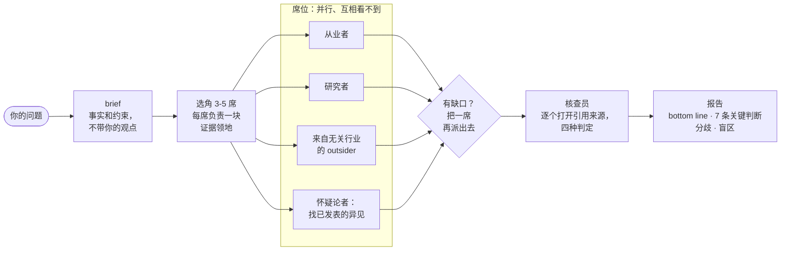

# family

> "I don't have friends. I got family." — Dominic Toretto


先把 family 叫齐，再干活。一个 Claude Code skill：对一个问题派出一组互相独立的席位，再派一名核查员把结论依赖的每个来源逐个打开。

[English](README.md) · 中文

```
/family  这个 skill 自己的设计里，哪些有证据，哪些是 folklore？
```



## 安装

```bash
git clone https://github.com/xhyumiracle/family-skill && ./family-skill/install.sh
```

需要带子代理和联网搜索的 Claude Code。装完开新会话。文件里不写任何模型名，席位用你的子代理默认模型。

## 用法

```
/family <问题>          3-5 席 + 核查员 · 约 25 分钟 · 约 70 万 token
/family quick <问题>    不派席位：编排者自己搜一遍，小核查员核一遍
/family deep <问题>     6 席 · 更大的核查预算 · 证据轮次直到分歧不再移动（最多 3 轮）
```

或者直接说「从0到1了解 X」「我对 X 还有什么没看到」。产物在 `family/<slug>/report.md`。

## 你拿到什么

首屏给十分钟读者，附录给审计。

| | |
|---|---|
| Bottom line | 该做什么 · 有多可能（七级刻度带数字区间）· 哪个假设一倒结论就倒 |
| 关键判断 | 最多七条，每条带最强的核查通过来源和「什么会改变它」 |
| 分歧 | 席位在哪里不一致，双方各有来源，什么能解决 |
| 盲区 | 没人查的 |
| 来源总评 | 证据由什么构成，核查员降级了哪些行 |

## 亮点

- **一名核查员把结论依赖的每个来源都打开。** 四种判定、两个旗标；截断后意思反转的引文算 MISQUOTED。整条流水线里证据最硬的一步。
- **有一席来自无关行业。** 按问题结构找类比（机器人和人往同一个 repo 提交的 CI 工程师；做独立估计的情报分析）。标注实验，留着是因为它总能找到盲区。
- **怀疑论者是唯一知道你怎么想的席位**，它去找已发表的反方，不自己编反驳。
- **席位盲写，从不互相辩论。** 同一个模型的席位达成一致是从众，不是证据。
- **编排者自己写的 bottom line 逐字对照核查表**，再给你看。
- **十分钟能读完的首屏，审计材料在折叠线下。** 三格结论、七级可能性刻度、最多七条关键判断、每个分歧写明什么能解决它。
- **它审计了自己两次**，v0.3 就是审出来的。

设计依据和每条选择背后的证据：[docs/DESIGN.md](docs/DESIGN.md)。

## 它审计了自己

[`examples/family-skill-v03/`](examples/family-skill-v03/)：五席（基准作者、十分钟读者、GRADE 方法学家、研究者、怀疑论者）读 v0.2.0 和文献，核查员打开 20 个来源。他们发现：新加的结构一次都没跑过，席位指标带选择偏差，编排者自己的 bottom line 混进了一处拼接的数字。v0.3.0 就是结果。

## 不适合

替你选 A 还是 B（它把证据摆出来，选是你的事）· 查单个事实 · 写长文 · 想省钱的调研。

## 参考文献

设计最依赖的几篇；完整清单和逐页说明在 [docs/DESIGN.md](docs/DESIGN.md)。

- Shao et al. *Assisting in Writing Wikipedia-like Articles From Scratch with LLMs*（STORM）. NAACL 2024. [arxiv.org/abs/2402.14207](https://arxiv.org/abs/2402.14207)
- Jiang et al. *Into the Unknown Unknowns*（Co-STORM）. EMNLP 2024. [arxiv.org/abs/2408.15232](https://arxiv.org/abs/2408.15232)
- Choi, Zhu, Li. *Debate or Vote: Which Yields Better Decisions in Multi-Agent LLMs?* NeurIPS 2025. [arxiv.org/abs/2508.17536](https://arxiv.org/abs/2508.17536)
- Zheng et al. *When "A Helpful Assistant" Is Not Really Helpful.* EMNLP Findings 2024. [arxiv.org/abs/2311.10054](https://arxiv.org/abs/2311.10054)
- Venkit et al. *DeepTRACE.* ICLR 2026. [arxiv.org/abs/2509.04499](https://arxiv.org/abs/2509.04499)
- Kim et al. *Towards a Science of Scaling Agent Systems.* 2025. [arxiv.org/abs/2512.08296](https://arxiv.org/abs/2512.08296)
- *Who is the Agent to Blame? Localizing Faithfulness and Citation Mistakes in Agentic Deep Research.* 2026. [arxiv.org/abs/2608.24306](https://arxiv.org/abs/2608.24306)
- Sharma et al. *Towards Understanding Sycophancy in Language Models.* ICLR 2024. [arxiv.org/abs/2310.13548](https://arxiv.org/abs/2310.13548)
- Nemeth, Brown, Rogers. *Devil's advocate versus authentic dissent.* Eur. J. Soc. Psychol. 2001.
- Lee et al. *"Fact-checking" fact checkers.* HKS Misinformation Review 2023.
- Mandel, Karvetski, Dhami. *Boosting intelligence analysts' judgment accuracy.* Judgment and Decision Making 2018.
- Intelligence Community Directive 203, *Analytic Standards.* 2015，2023 修订.
- Rosenbaum, Glenton, Oxman. *Summary-of-findings tables in Cochrane reviews improved understanding and rapid retrieval of key information.* J Clin Epidemiol 2010.
- Miller. *Adding Error Bars to Evals.* 2024. [arxiv.org/abs/2411.00640](https://arxiv.org/abs/2411.00640)
- Anthropic. *How we built our multi-agent research system.* 2025. [anthropic.com/engineering/multi-agent-research-system](https://www.anthropic.com/engineering/multi-agent-research-system)

MIT · 动手前读过：claude-storm、storm-research、panel-skill、perspectives-skill、dotclaude · 剧照来自《速度与激情5》，Universal Pictures
