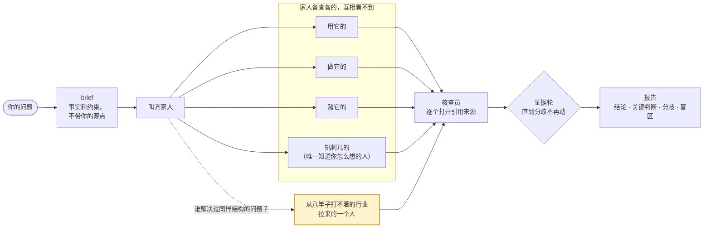

# family

> "I don't have friends. I got family." — Dominic Toretto


先有 family，后有天。一个 Claude Code skill：一个问题，先从各行各业拉一帮家人各查各的，再派个核查员把他们引用的每个来源挨个打开。

[English](README.md) · 中文

```
/family  family 这套多角色调研法，哪些设计有证据，哪些是 folklore？
```



## 安装

```bash
git clone https://github.com/xhyumiracle/family-skill && ./family-skill/install.sh
```

要能开子代理、能联网搜索的 Claude Code。装完重开一个会话。文件里没写任何模型名，每个家人都用你自己的子代理默认模型。

## 用法

```
/family <问题>          5 个家人 + 核查员 · 约 30 分钟 · 约 65 万 token
/family quick <问题>    不组队，编排者自己查一遍，小核查员再核一遍
/family deep <问题>     同一批家人 · 更大的核查预算 · 证据轮直到分歧不再移动（最多 3 轮）
```

或者直接说人话：「从0到1了解一下 X」「X 的 hype 是真的吗」「我对 X 还漏了什么」。东西都在 `family/<slug>/report.md`。

## 报告长什么样

前半页是给只有十分钟的人看的，后面是审计材料。

| | |
|---|---|
| 结论 | 该做什么 · 有多大可能（七级刻度，带数字区间）· 哪个假设一倒结论就倒 |
| 关键判断 | 最多七条，每条附最硬的来源，以及什么情况下它会变 |
| 分歧 | 哪几个家人在哪儿不一致，各自的证据，什么能解决 |
| 盲区 | 没人查的地方 |
| 来源总评 | 证据是什么成色，核查员降了哪几条 |

## 亮点

- **有个核查员，结论依赖的每个来源它都会打开。** 只有四种判定、两个旗标；引文截一半把意思截反了，直接算 MISQUOTED。整条流水线里证据最硬的就是这一步。
- **有个家人是从八竿子打不着的行业拉来的。** 看问题的结构去找人：机器人和人往同一个 repo 提交，去找 CI 工程师；一群人各自估计再汇总，去找情报分析员。标了「实验性」，但一直留着，因为它老能翻出别人没看的角落。
- **怀疑论者是唯一知道你怎么想的人。** 它的活是去找已经发表的反方，而不是自己编反驳。
- **家人各查各的，谁也不跟谁吵。** 同一个模型扮的几个人意见一致，那叫从众，不叫证据。
- **编排者自己写的结论，逐字对着核查表过一遍**，然后才给你看。
- **十分钟能看完的前半页，审计材料在后面。**
- **它审过自己两回**，v0.3 就是审出来的。

每条设计的依据和证据：[docs/DESIGN.md](docs/DESIGN.md)。

## 拿它审它自己

[`examples/family-skill-v03/`](examples/family-skill-v03/)：五个家人，一个写 deep-research 评测基准的，一个只有十分钟就得拍板的读者，一个从医学证据分级那边拉来的 GRADE 方法学家，一个只看消融表的研究员，一个怀疑论者。核查员打开了 20 个来源。查出来三件事：上一版新加的结构压根没跑过，每个家人贡献多少的计数有选择偏差，编排者自己写的结论里混进了一个拼接出来的数字。v0.3.0 就是这么来的。

## 它不干什么

替你选 A 还是 B（证据摆给你，选是你的事）· 查一个事实 · 写长文 · 省钱。

## 参考文献

设计上最依赖的几篇，完整清单和逐页说明见 [docs/DESIGN.md](docs/DESIGN.md)。

- Shao et al. *Assisting in Writing Wikipedia-like Articles From Scratch with LLMs*（STORM）. NAACL 2024. [arxiv.org/abs/2402.14207](https://arxiv.org/abs/2402.14207)
- Jiang et al. *Into the Unknown Unknowns*（Co-STORM）. EMNLP 2024. [arxiv.org/abs/2408.15232](https://arxiv.org/abs/2408.15232)
- Choi, Zhu, Li. *Debate or Vote: Which Yields Better Decisions in Multi-Agent LLMs?* NeurIPS 2025. [arxiv.org/abs/2508.17536](https://arxiv.org/abs/2508.17536)
- Zheng et al. *When "A Helpful Assistant" Is Not Really Helpful.* EMNLP Findings 2024. [arxiv.org/abs/2311.10054](https://arxiv.org/abs/2311.10054)
- Venkit et al. *DeepTRACE.* ICLR 2026. [arxiv.org/abs/2509.04499](https://arxiv.org/abs/2509.04499)
- Kim et al. *Towards a Science of Scaling Agent Systems.* 2025. [arxiv.org/abs/2512.08296](https://arxiv.org/abs/2512.08296)
- *Who is the Agent to Blame? Localizing Faithfulness and Citation Mistakes in Agentic Deep Research.* 2026. [arxiv.org/abs/2608.24306](https://arxiv.org/abs/2608.24306)
- Sharma et al. *Towards Understanding Sycophancy in Language Models.* ICLR 2024. [arxiv.org/abs/2310.13548](https://arxiv.org/abs/2310.13548)
- Nemeth, Brown, Rogers. *Devil's advocate versus authentic dissent.* Eur. J. Soc. Psychol. 2001.
- Lee et al. *"Fact-checking" fact checkers.* HKS Misinformation Review 2023.
- Mandel, Karvetski, Dhami. *Boosting intelligence analysts' judgment accuracy.* Judgment and Decision Making 2018.
- Intelligence Community Directive 203, *Analytic Standards.* 2015，2023 修订.
- Rosenbaum, Glenton, Oxman. *Summary-of-findings tables in Cochrane reviews improved understanding and rapid retrieval of key information.* J Clin Epidemiol 2010.
- Miller. *Adding Error Bars to Evals.* 2024. [arxiv.org/abs/2411.00640](https://arxiv.org/abs/2411.00640)
- Anthropic. *How we built our multi-agent research system.* 2025. [anthropic.com/engineering/multi-agent-research-system](https://www.anthropic.com/engineering/multi-agent-research-system)

MIT · 动手前读过：claude-storm、storm-research、panel-skill、perspectives-skill、dotclaude · 剧照来自《速度与激情5》，Universal Pictures
