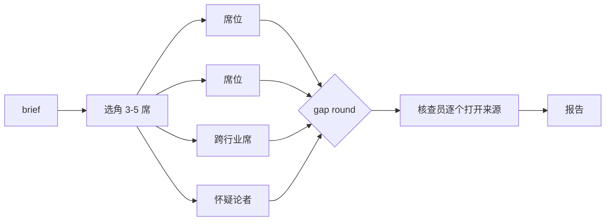

# family

> "I don't have friends. I got family." — Dominic Toretto


先把 family 叫齐，再干活。一个 Claude Code skill：对一个问题派出一组互相独立的席位，再派一名核查员把结论依赖的每个来源逐个打开。

[English](README.md) · 中文

```
/family  这个 skill 自己的设计里，哪些有证据，哪些是 folklore？
```



## 安装

```bash
git clone https://github.com/xhyumiracle/family-skill && ./family-skill/install.sh
```

需要带子代理和联网搜索的 Claude Code。装完开新会话。文件里不写任何模型名，席位用你的子代理默认模型。

## 用法

```
/family <问题>          3-5 席 + 核查员 · 约 25 分钟 · 约 70 万 token
/family quick <问题>    一次调研 + 小核查
/family deep <问题>     6 席 · 更大的核查预算 · 默认开 gap round
```

或者直接说「从0到1了解 X」「我对 X 还有什么没看到」。产物在 `family/<slug>/report.md`。

## 你拿到什么

首屏给十分钟读者，附录给审计。

| | |
|---|---|
| Bottom line | 该做什么 · 有多可能（七级刻度带数字区间）· 哪个假设一倒结论就倒 |
| 关键判断 | 最多七条，每条带最强的核查通过来源和「什么会改变它」 |
| 分歧 | 席位在哪里不一致，双方各有来源，什么能解决 |
| 盲区 | 没人查的 |
| 来源总评 | 证据由什么构成，核查员降级了哪些行 |

## 规则，以及为什么

| 规则 | 因为 | |
|---|---|---|
| 席位盲写，之后一个人写 | 辩论的收益不比投票多；同伴意见会把对的翻错 | [1] [2] |
| 席位是搜索领地，不是人设 | 人设不提高准确率；不同来源才会 | [3] [4] [5] |
| 你的观点只给怀疑论者 | 写进提示的信念会把答案拉过去 | [6] |
| 怀疑论者去找已发表的异见 | 指派的 devil's advocate 不如真实异见 | [7] |
| 一名核查员，四种判定 | 生产系统引用准确率 40-80%；细标签不可复现 | [8] [9] [10] |
| bottom line 逐字核对 | 最终报告的错误大多出在编排者 | [11] |
| 关键判断 ≤7 条、可能性刻度、审计放折叠线下 | 情报产品和系统综述面对同一类读者收敛出的形状 | [12] [13] [14] |
| 先加每席搜索次数，再加席位 | token 预算解释 80% 的方差 | [15] |
| 跨行业席和 gap round：默认开，标注实验 | 还没有对照研究 | |

出处和完整论证：[docs/DESIGN.md](docs/DESIGN.md)。

## 它审计了自己

[`examples/family-skill-v03/`](examples/family-skill-v03/)：五席（基准作者、十分钟读者、GRADE 方法学家、研究者、怀疑论者）读 v0.2.0 和文献，核查员打开 20 个来源。他们发现：新加的结构一次都没跑过，席位指标带选择偏差，编排者自己的 bottom line 混进了一处拼接的数字。v0.3.0 就是结果。

## 不适合

A 还是 B 的决策 · 查单个事实 · 写长文 · 想省钱的调研。

MIT · STORM：Shao et al., NAACL 2024 · 组队的想法来自一篇小红书帖子 · 动手前读过：claude-storm、storm-research、panel-skill、perspectives-skill、dotclaude · 剧照来自《速度与激情5》，Universal Pictures
