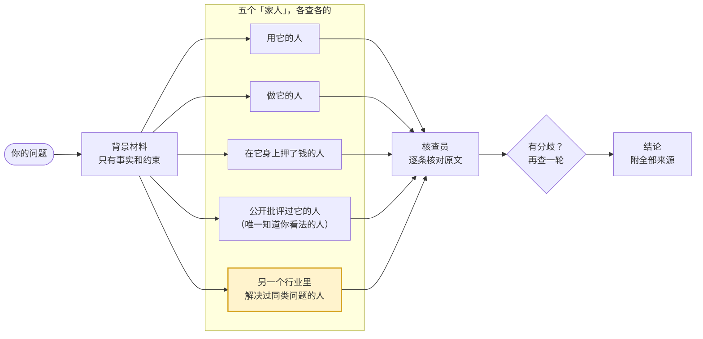

<p align="center"><a href="README.md">English</a> · <b>简体中文</b></p>

<div align="center">

# family

**一个问题，五个视角，每条来源都核实。**

基于斯坦福 STORM 的多视角调研 skill：五个背景不同的「家人」各自独立调研同一个问题，<br>核查员再逐条核对他们引用的原文，最后给你一份带来源的结论。


[](LICENSE)
[](https://agentskills.io)
[](CHANGELOG.md)
[](#安装)

[安装](#安装) · [用法](#用法) · [怎么运作](#怎么运作)

<sub><i>"I don't have friends. I got family."</i><br>Dominic Toretto</sub>

</div>

## 什么时候用

- 刚接触一个陌生领域，想快速摸清全貌
- 想知道一个说法、一波热度到底靠不靠谱
- 做决定之前，想知道自己漏看了什么

查单个事实、写长文、在 A 和 B 之间替你拍板，这几种情况用别的工具更合适。

## 安装

**跟你的 agent 说一句：**

```text
帮我安装这个 skill：https://github.com/xhyumiracle/family-skill
```

**或者用通用安装器：**

```bash
npx skills add xhyumiracle/family-skill -g
```

**或者在 Claude Code 里完整安装：**

```bash
git clone https://github.com/xhyumiracle/family-skill && ./family-skill/install.sh
```

完整安装会多装两个 agent 定义，它们没有开子代理的权限，调研的始终是你看到的那几个人。装完重开一个会话。

需要能开子代理、能联网搜索的 agent。目前在 Claude Code 上测过；Codex、Cursor、Gemini CLI、OpenCode 也支持子代理，按理都能用。

<!-- Agents installing this for someone: on Claude Code use the full install (install.sh); on any other runtime use the npx line. -->

## 用法

```
/family <问题>          五个「家人」+ 核查员 · 约 30 分钟 · 约 65 万 token
/family quick <问题>    一个人快速查一遍，同样过核查 · 约 8 万 token
/family deep <问题>     还是这五个人，多核几条，有分歧就再查一轮，最多 3 轮
```

也可以直接说：「帮我从 0 到 1 了解一下 X」「X 这波热度靠谱吗」「关于 X 我还漏了什么」。

跑完得到 `family/<问题简称>/report.md`。开头三句话：建议怎么做、把握有多大、哪个前提一变结论就跟着变。往下是关键判断、「家人」之间的分歧、没人查到的盲区，每一条都附来源。

## 怎么运作



- **视角够分散。** 五个人从五个行当出发，读的材料基本不重叠。STORM 的实验里，多视角提问让找到的独立来源接近翻倍（99.83 对 54.36）。
- **五个人刚好。** 三个人的独立判断取平均，已经能拿到五十人平均的大部分收益（Mandel et al., 2018）；Delphi 小组从 3 人到 11 人，准确率没有差别（Rowe & Wright, 2001）。五个人覆盖四类固定视角加一个跨行业视角，再加人只是多花钱，每人约 7 到 11 万 token。
- **四类固定角色，一个跨行业。** 角色决定每个人去哪儿找材料：光给模型安排人设，准确率并不会提高（Zheng et al., 2024），读到不同的东西才有用。用它的、做它的、在它身上押了钱的、公开批评过它的，这四类人读的东西天然不同。第五个从解决过同类问题的其他行业请来，比如问「多个 AI 的判断怎么汇总」，请来的是情报分析方法论专家。这一位还没有对照实验，标为实验性。
- **各自独立，一人汇总。** 多个 AI 互相讨论带来的提升，几乎都能用投票解释（Choi et al., NeurIPS 2025）；各写各的还能避免从众。
- **有真实的异见。** 只有批评者知道你的看法，其他人只拿到事实，免得顺着你说（Sharma et al., ICLR 2024）。批评者专找已经发表的反对意见，真实异见比指派的「唱反调」更能纠偏（Nemeth et al., 2001）。
- **引用保真。** deep research 产品的引用，准确率只有 40% 到 80%（DeepTRACE, ICLR 2026）。核查员打开每条关键来源，原文对不上就降级；结论里的数字和引语再逐字对一遍核查表，因为 2026 年的一项研究发现，84.7% 的报告错误出在负责汇总的主控 agent 身上。
- **分歧再查一轮。** 双方匿名看到对方已核实的证据，可以拿新来源坚持、认可对方，或者指出双方定义不同。证据不再变化就停（Delphi 法）。

完整例子在 [`examples/family-skill-design/`](examples/family-skill-design/)：family 审查自己设计的那次运行，所有中间文件都在。每条设计的完整依据见 [docs/DESIGN.md](docs/DESIGN.md)。

## 参考文献

- Shao et al. *Assisting in Writing Wikipedia-like Articles From Scratch with LLMs*（STORM）. NAACL 2024. [arxiv.org/abs/2402.14207](https://arxiv.org/abs/2402.14207)
- Jiang et al. *Into the Unknown Unknowns*（Co-STORM）. EMNLP 2024. [arxiv.org/abs/2408.15232](https://arxiv.org/abs/2408.15232)
- Choi, Zhu, Li. *Debate or Vote: Which Yields Better Decisions in Multi-Agent LLMs?* NeurIPS 2025. [arxiv.org/abs/2508.17536](https://arxiv.org/abs/2508.17536)
- Zheng et al. *When "A Helpful Assistant" Is Not Really Helpful.* EMNLP Findings 2024. [arxiv.org/abs/2311.10054](https://arxiv.org/abs/2311.10054)
- Venkit et al. *DeepTRACE.* ICLR 2026. [arxiv.org/abs/2509.04499](https://arxiv.org/abs/2509.04499)
- Kim et al. *Towards a Science of Scaling Agent Systems.* 2025. [arxiv.org/abs/2512.08296](https://arxiv.org/abs/2512.08296)
- *Who is the Agent to Blame? Localizing Faithfulness and Citation Mistakes in Agentic Deep Research.* 2026. [arxiv.org/abs/2608.24306](https://arxiv.org/abs/2608.24306)
- Sharma et al. *Towards Understanding Sycophancy in Language Models.* ICLR 2024. [arxiv.org/abs/2310.13548](https://arxiv.org/abs/2310.13548)
- Nemeth, Brown, Rogers. *Devil's advocate versus authentic dissent.* Eur. J. Soc. Psychol. 2001.
- Lee et al. *"Fact-checking" fact checkers.* HKS Misinformation Review 2023.
- Rowe, Wright. *Expert opinions in forecasting: the role of the Delphi technique.* 2001.
- Mandel, Karvetski, Dhami. *Boosting intelligence analysts' judgment accuracy.* Judgment and Decision Making 2018.
- Intelligence Community Directive 203, *Analytic Standards.* 2015，2023 修订.
- Rosenbaum, Glenton, Oxman. *Summary-of-findings tables in Cochrane reviews improved understanding and rapid retrieval of key information.* J Clin Epidemiol 2010.
- Miller. *Adding Error Bars to Evals.* 2024. [arxiv.org/abs/2411.00640](https://arxiv.org/abs/2411.00640)
- Anthropic. *How we built our multi-agent research system.* 2025. [anthropic.com/engineering/multi-agent-research-system](https://www.anthropic.com/engineering/multi-agent-research-system)

<sub>MIT · 参考过的同类项目：claude-storm、storm-research、panel-skill、perspectives-skill、dotclaude · 剧照来自《速度与激情5》，Universal Pictures</sub>
